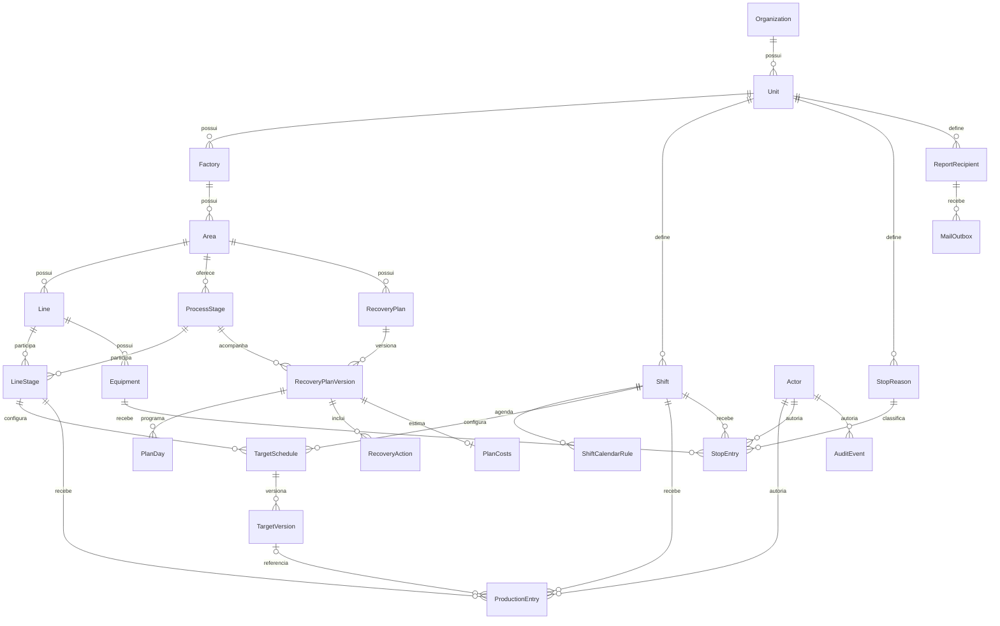

# Modelo lógico e físico

O domínio operacional é relacional, sem colunas JSON para produção, metas, permissões ou planejamento. O esquema executável está em `apps/api/prisma/schema.prisma`, e a migração SQL inicial está em `apps/api/prisma/migrations/202611220001_normalized/migration.sql`.

## Normalização

- **1FN:** cada atributo é atômico; dias, ações, calendários, traduções e destinatários têm relações próprias. Não há listas de equipamentos, linhas ou permissões serializadas no banco.
- **2FN:** atributos dependem da chave completa. As relações `LineStage`, traduções e referências legadas possuem chaves alternativas/compostas explícitas.
- **3FN:** unidade/fábrica/área não são repetidas nos lançamentos; são alcançadas pelas FKs. Nomes de linha, turno e equipamento não são copiados para produção/paradas. PPM, eficiência, saldo e totais são calculados, não armazenados como verdade operacional.
- A duração de parada é calculada quando há início/fim reais. `reportedDurationMinutes` é preenchido **somente** quando os horários não existem, para preservar relatórios legados. Um CHECK impede guardar duração redundante junto dos horários.
- Uma meta usa CAP + percentual ou uma meta histórica em peças, sem guardar os dois modos simultaneamente. `TargetVersion.kind=SNAPSHOT` preserva a referência de um lançamento legado sem se tornar a configuração para novos lançamentos. `CONFIGURATION` vale para novas entradas conforme a vigência.
- Contadores de revisão nos agregados são controles de concorrência. Versões anteriores e seus filhos são imutáveis. O histórico de um plano referencia suas próprias linhas normalizadas.

`AuditEvent.before/after` são a única exceção JSON: evidência técnica imutável de uma alteração, nunca fonte das consultas operacionais. `MailOutbox.text` guarda uma mensagem pronta para entrega. Essas cópias técnicas são deliberadas e não substituem as relações do domínio.

## Dicionário resumido

| Relação                              | Responsabilidade / chave alternativa                                                             |
| ------------------------------------ | ------------------------------------------------------------------------------------------------ |
| Organization                         | Organização; `code` único                                                                        |
| Unit                                 | Unidade e fuso IANA; `(organizationId, code)`; `accessKey` único para vínculo com escopo externo |
| Factory / Area / Line                | Hierarquia; código único dentro do pai                                                           |
| ProcessStage / LineStage             | Etapa da área e vínculo N:N com linhas da mesma área                                             |
| StageTranslation / ReasonTranslation | Nome por idioma; chave `(entidade, locale)`                                                      |
| Equipment                            | Equipamento da linha; centro de trabalho e patrimônio opcionais                                  |
| Shift / ShiftCalendarRule            | Turno da unidade, minutos locais e recorrências semanais/alternadas                              |
| Actor                                | Somente `issuer`, `subject`, `displayName` e ID para autoria; **não concede acesso**             |
| TargetSchedule / TargetVersion       | Meta por linha-etapa-turno, revisão, vigência, CAP/percentual ou quantidade histórica            |
| ProductionEntry                      | Data operacional, quantidade, defeitos, produção extra, turno e versão de meta                   |
| StopReason / StopEntry               | Motivo por unidade, equipamento, turno, comentário e tempo real ou duração informada             |
| RecoveryPlan / RecoveryPlanVersion   | Plano da área e cenários imutáveis, com etapa, linha opcional e atraso inicial                   |
| PlanDay / RecoveryAction / PlanCosts | Programação diária, ações e parâmetros de custo de cada versão                                   |
| AuditEvent                           | Autor, ação, instante, unidade e evidência técnica                                               |
| LegacyReference                      | `(source, entityType, sourceId)` → UUID de destino + checksum; impede reimportação divergente    |
| ReportRecipient / MailOutbox         | Destinatário operacional por unidade e fila de entrega                                           |

IDs são UUIDs, datas operacionais usam `date`, instantes usam `timestamptz`, valores monetários e percentuais usam `numeric`. FKs usam `RESTRICT` no domínio histórico. CHECKs validam quantidades, defeitos, tempos, custos e vigências básicas. Triggers reforçam limites de unidade/área e imutabilidade, inclusive fora da API.

Não existem `User`, `Role`, `Permission`, `Membership`, senhas ou flags de administrador no modelo. As tabelas técnicas de sessão ficam fora do PostgreSQL: o Redis guarda somente sessões efêmeras, tokens cifrados e proteção contra replay de logout.

## Calendário e concorrência

A data operacional corresponde ao **dia de início do turno**, inclusive ao atravessar a meia-noite. Horários são interpretados no fuso da unidade. Uma regra de domingo com intervalo 2 usa a semana da data de referência como semana habilitada. Na ausência de regra específica, valem os horários básicos do turno; a TI/área deve cadastrar o calendário oficial.

Alterações de metas e planos usam revisão esperada e transação serializável. Edições de produção/paradas usam `version`. Em conflito, a API retorna `409 revision_conflict` e exige nova consulta. Edição por proprietário também depende do turno ativo; permissões corporativas de edição ampla permitem correções históricas, com auditoria.
